<div align="center">



<a href="https://rahul9121.github.io/portfolio/"></a>
  <a href="mailto:rahulega695@gmail.com"></a>
  <a href="https://www.linkedin.com/in/REPLACE_LINKEDIN"></a>
  <a href="https://rahul9121.github.io/portfolio/assets/Rahul_Ega_Resume.pdf"></a>

</div>

<br />



Hi, I'm Rahul. I'm a data engineer based in New Jersey with five-plus years of building pipelines for tech and finance teams. Right now I'm at Meta, and before that I was at Bank of America and Fidelity.

Most of my work sits in the middle of the data stack. Events come in through Kafka, get cleaned up and reshaped in PySpark, land in Delta Lake or Snowflake, and get modeled in dbt so analysts can trust the numbers. I also write the checks that catch schema drift and bad data before anyone downstream sees it, and I spend a fair bit of time making slow Spark jobs faster.

I'm open to my next senior data engineer role anywhere in the US: remote, hybrid, or on-site, contract or full-time.

```json
{
  "role": "Senior Data Engineer",
  "location": "New Jersey, USA",
  "open_to": "Roles across the US · remote / hybrid / on-site",
  "education": "MS Computer Science · Montclair State University",
  "focus": "Batch and streaming data platforms"
}
```

<br />


What I work with day to day.

**Languages**
<p>
  
  
  
  
  
</p>
**Processing and storage**
<p>
  
  
  
  
  
  
  
</p>
**Cloud and warehouse**
<p>
  
  
  
  
  
  
</p>
**Databases**
<p>
  
  
  
</p>
**Orchestration and tooling**
<p>
  
  
  
  
  
  
</p>

<br />



I'm building six projects to show how I work, from streaming to migrations. Each one gets a live demo and its own repo as it ships. None are finished yet, so for now every card opens the status page on my site.

<table>
  <tr>
    <td width="50%" valign="top"><a href="https://rahul9121.github.io/portfolio/under-construction.html"></a></td>
    <td width="50%" valign="top"><a href="https://rahul9121.github.io/portfolio/under-construction.html"></a></td>
  </tr>
  <tr>
    <td width="50%" valign="top"><a href="https://rahul9121.github.io/portfolio/under-construction.html"></a></td>
    <td width="50%" valign="top"><a href="https://rahul9121.github.io/portfolio/under-construction.html"></a></td>
  </tr>
  <tr>
    <td width="50%" valign="top"><a href="https://rahul9121.github.io/portfolio/under-construction.html"></a></td>
    <td width="50%" valign="top"><a href="https://rahul9121.github.io/portfolio/under-construction.html"></a></td>
  </tr>
</table>

<br />


**Senior Data Engineer, Meta** `Jan 2026 – now · contract · USA`
PySpark and Kafka pipelines on Azure Databricks, writing to Delta Lake on ADLS. dbt models on top, Airflow for scheduling, and data quality checks inside the pipelines so problems show up early.

**Data Engineer, Bank of America** `Jun 2024 – Dec 2025 · contract · USA`
PySpark ETL into Snowflake, dbt dimensional models for the warehouse, and Azure Data Factory for orchestration. I also wrote a lot of SQL for reconciliation and for the compliance teams.

**Data Engineer, Fidelity Investments** `Feb 2021 – Aug 2023 · full time · Hyderabad, India`
Hive and PySpark jobs on Hadoop, Kafka ingestion from trading and transaction systems, and a migration of on-prem jobs to Azure, with every output tested against the legacy baseline.

**Education:** MS in Computer Science, Montclair State University, May 2025.

<br />


The easiest way to reach me is email. If you're hiring for a senior data engineer role, or you just want to talk pipelines, send me a message and I'll get back to you.

<div align="center">

<a href="https://rahul9121.github.io/portfolio/"></a>
  <a href="mailto:rahulega695@gmail.com"></a>
  <a href="https://www.linkedin.com/in/REPLACE_LINKEDIN"></a>
  <a href="https://rahul9121.github.io/portfolio/assets/Rahul_Ega_Resume.pdf"></a>

<sub>RE-2026 · New Jersey, USA</sub>

</div>
